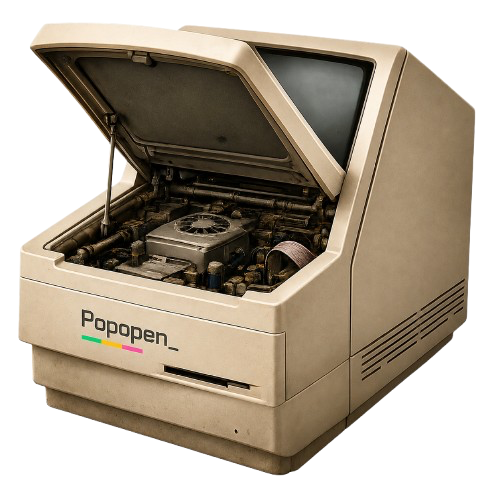

<div align="center">



<p>A local workspace for browsing, editing, and moving coding-agent skills.<br/>Run <code>popopen</code> to open your skill library.</p>

[](https://www.npmjs.com/package/popopen)
[](https://www.npmjs.com/package/popopen)
[](LICENSE)
[](https://nodejs.org)

</div>

---

## Install

```bash
npm install -g popopen
```

**Requirements:** Node.js 20.19+

## Usage

```bash
popopen
```

Popopen starts a local web server and opens its UI in your default browser. The CLI uses macOS's `open` command to launch the browser. If it detects an existing Popopen process, it opens the UI again.

Automatic browser opening is macOS-specific; the server itself binds to localhost.

You can also run it without a global install:

```bash
npx popopen
```

```bash
PORT=4000 popopen   # use a different port
```

## Features

- **Browse & edit skills** — scan global, project, and configured external skill folders for Claude Code, Codex, OpenCode, Hermes, and Pi; browse discovered skill files and preview Markdown with rendered headings, links, lists, tables, and code blocks
- **See every copy** — merge agent-path aliases to the same folder, while keeping separate same-named folders distinct and showing the agents that can discover each
- **Frontmatter editor** — toggle skill settings (`disable-model-invocation`, descriptions, etc.) without touching raw YAML
- **Search** — filter the skill library by name, description, file name, agent, and location
- **Dashboard** — usage analytics (views, edits, saves) tracked locally
- **Backpack** — follow a guided packing flow: choose skill copies, watch them fill a backpack, then download a ZIP with an inventory and agent-readable setup instructions; the receiving computer does not need Popopen
- **Bulk operations** — batch toggle frontmatter fields and compare declared tools across selected copies
- **Update checker** — checks eligible installed skills against their GitHub source; applying an update runs the Claude Code CLI through `npx`
- **Uninstall** — remove installed or custom skills from the UI

## How it works

Popopen is a local Express server. It scans documented global and project skill directories for Claude Code, Codex, OpenCode, Hermes, and Pi. Hermes external directories are read from `~/.hermes/config.yaml`. A project skill is not treated as replacing a global copy: each on-disk copy appears separately, with its location and supported agents shown in the library. Hermes project skills are marked untrusted until the current project is trusted in Hermes settings.

The Backpack flow opens from the sidebar and walks through choosing skill copies, packing them, and handing them off. The result is a standard ZIP containing each selected skill folder, `manifest.json`, and `AGENT-INSTRUCTIONS.md`. Extract it or point a coding agent at the ZIP and ask the agent to install the selected skills. The instructions list common agent locations and require the agent to ask before replacing an existing same-named skill. Popopen is not required on the receiving computer.

The server binds to `127.0.0.1` only and is not accessible from other machines on your network.

Analytics are stored locally in `~/.popopen/analytics.json`. The update checker contacts the GitHub API; applying an update invokes the Claude Code CLI through `npx`.

Use `SKILLS_DIR` to override the Claude-compatible global skills directory and `LOCAL_SKILLS_DIR` to override the Claude-compatible project skills directory. Other agent paths follow their documented defaults. The project directory defaults to the current working directory's `.claude/skills`.

## Local Development

```bash
git clone https://github.com/mriziq/popopen.git
cd popopen
npm install
npm run dev
```

Starts the Express server at `http://localhost:3377`. Refresh the browser to pick up UI changes during development.

To use alternate skills directories during development:

```bash
SKILLS_DIR=~/my-global-skills LOCAL_SKILLS_DIR=~/my-project-skills npm run dev
```

The entry point is `server/index.js`. Static assets are served from `public/`. API routes live under `server/routes/`; skill discovery and filesystem operations are in `server/lib/scanner.js`.

## Uninstall

```bash
npm uninstall -g popopen
```

---

<div align="center">
<sub>Built for coding agents · <a href="https://github.com/mriziq/popopen/releases">Changelog</a> · <a href="docs/releasing.md">Contributing</a></sub>
</div>
